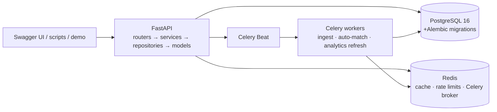

# CareerOps

Track every application, score every job description against your profile, and
see which skills the market actually wants.

CareerOps is a Python backend API (FastAPI + async SQLAlchemy + PostgreSQL +
Redis + Celery) and the author's flagship backend portfolio project. It is
used daily by its author to run a real job search.

> Status: all six phases built. 166 tests, 98.4% coverage. Numbers below are
> measured in this repo — nothing is estimated (see `docs/PERFORMANCE.md`).

## Features

- **Application tracker** — CRUD, a guarded status state machine
  (`saved → applied → oa → interview → offer`, plus `rejected`/`withdrawn`),
  append-only status history, timestamped notes, follow-up reminders, filtered
  list with pagination, CSV export.
- **JD match scoring** — deterministic 0–100 score from required-skill
  coverage, preferred-skill coverage, experience fit, and title similarity,
  with a per-component breakdown, matched/missing skills, and resume
  suggestions. An optional LLM explanation sits behind a flag and can never
  move the number. Skill extraction measured at P=R=1.000 over 20 labeled JDs.
- **Listing ingestion** — Celery + Beat pipeline over three legitimate public
  APIs (Greenhouse boards, Lever postings, RemoteOK feed), normalized,
  deduplicated by `(source, external_id)` plus cross-source content hash,
  retried with backoff, per-source throttled, skill-tagged, with an
  `IngestionRun` ledger per run. CSV/JSON import included. Nightly auto-match
  scores new listings against your profile.
- **Analytics** — top skills, co-occurrence, salary bands, posting trends, and
  a personal skill gap, computed in SQL over a precomputed summary table with
  Redis caching.
- **Platform** — JWT access + rotating refresh tokens + API keys, per-user
  rate limiting, audit log, structured JSON logs with request IDs and
  `duration_ms`, standard error envelope, Alembic migrations throughout.

## Architecture



## Quickstart

```bash
make services   # Postgres + Redis for local dev (needs Docker)
make migrate    # alembic upgrade head
make seed       # demo user + realistic data (demo@careerops.dev / demo1234)
make run        # uvicorn app.main:app --reload → http://localhost:8000/docs
```

Then: `make test` (pytest, 80% gate), `make lint`
(ruff check + format --check + mypy strict), `make worker` / `make beat`
(Celery; needs Redis).

## API overview

| Area | Endpoints |
|---|---|
| Ops | `GET /health`, `GET /ready` |
| Auth | `POST /auth/register`, `/login`, `/refresh`, `/logout`, `GET /me`, `POST/GET/DELETE /auth/api-keys` |
| Tracker | CRUD `/applications`, `POST /{id}/status`, notes, reminders, `GET /reminders/due`, `GET /export.csv` |
| Match | `POST /match`, `POST /match/{application_id}`, `GET /match/history`, `GET/PUT /profile` |
| Listings | `GET /listings`, `GET /listings/{id}`, `POST /listings/import`, `GET /ingestion/runs` |
| Analytics | `GET /analytics/skills/top`, `/skills/cooccurrence`, `/salary`, `/trends`, `/my-gap` |

Errors always look like `{"error": {"code": "...", "message": "..."}}`.
List endpoints return `{"items": [...], "total": N, "limit": L, "offset": O}`.

### Example session (real responses, trimmed, from a seeded run)

Register and log in:

```bash
curl -X POST localhost:8000/auth/register \
  -H 'Content-Type: application/json' \
  -d '{"email": "demo@careerops.dev", "password": "demo1234"}'
```

```json
{
  "id": "c7fed45f-7af7-458a-a63d-3e9a473ad261",
  "email": "demo@careerops.dev",
  "created_at": "2026-10-12T07:15:40"
}
```

```bash
curl -X POST localhost:8000/auth/login \
  -H 'Content-Type: application/json' \
  -d '{"email": "demo@careerops.dev", "password": "demo1234"}'
```

```json
{
  "access_token": "…",
  "refresh_token": "…",
  "token_type": "bearer"
}
```

Track an application and move it through the pipeline:

```bash
export TOKEN=<access_token>
curl -X POST localhost:8000/applications \
  -H "Authorization: Bearer $TOKEN" -H 'Content-Type: application/json' \
  -d '{"company": "Acme", "title": "Backend Engineer"}'
```

```json
{
  "id": "f75aa4ae-eb4b-404b-a4f1-3a7a4c0479fd",
  "title": "Backend Engineer",
  "status": "saved",
  "company": {"id": "41c3e54d-…", "name": "Acme", "website": null}
}
```

```bash
curl -X POST localhost:8000/applications/<id>/status \
  -H "Authorization: Bearer $TOKEN" -H 'Content-Type: application/json' \
  -d '{"to_status": "applied"}'
# → 200, "status": "applied" (illegal jumps → 409)
```

Score a job description against your profile:

```bash
curl -X POST localhost:8000/match \
  -H "Authorization: Bearer $TOKEN" -H 'Content-Type: application/json' \
  -d '{"title": "Backend Engineer",
       "text": "Backend Engineer.\nRequirements:\n- 3 years of Python and FastAPI.\nNice to have:\n- Docker."}'
```

```json
{
  "id": "62056b70-…",
  "score": 55,
  "breakdown": {
    "required":  {"score": 50,  "weight": 0.5, "matched": ["Python"], "missing": ["FastAPI"]},
    "preferred": {"score": 0,   "weight": 0.2, "matched": [],        "missing": ["Docker"]},
    "experience": {"score": 100, "weight": 0.2, "profile_years": 4.0, "required_years": 3},
    "title": {"score": 100, "weight": 0.1, "jd_title": "Backend Engineer",
              "matched_role": "Backend Engineer"}
  },
  "matched_skills": ["Python"],
  "missing_skills": ["FastAPI", "Docker"],
  "suggestions": [
    "Add FastAPI to your resume or profile — it is required.",
    "Learning Docker would strengthen this application."
  ],
  "llm_explanation": null
}
```

Import listings and read the market:

```bash
curl -X POST localhost:8000/listings/import \
  -H "Authorization: Bearer $TOKEN" -H 'Content-Type: application/json' \
  -d '{"format": "json", "records": [{"title": "Backend Engineer", "company": "Acme",
       "description": "Python required."}]}'
# → {"fetched": 1, "inserted": 1, "skipped": 0, "errors": 0}

curl 'localhost:8000/analytics/skills/top' -H "Authorization: Bearer $TOKEN"
# → {"items": [{"skill": "Python", "postings": 1}], "total_skills": 1}
```

## Tech stack

Python 3.12, FastAPI, Pydantic v2, SQLAlchemy 2.0 (async), Alembic,
PostgreSQL 16, Redis, Celery + Beat, JWT, Pytest + pytest-asyncio + httpx +
respx, Ruff, mypy (strict), uv. Docker Compose runs local Postgres + Redis
only.

## Testing and coverage

- 166 tests, 98.4% coverage (gate: 80%). `make lint test` must pass before
  every commit.
- No Docker needed for tests: sqlite (aiosqlite) + fakeredis + respx stand in
  for Postgres/Redis/network; live-service paths are documented per phase in
  `docs/DECISIONS.md`.
- Skill extraction: precision = recall = 1.000 over 20 labeled JDs in
  `tests/fixtures/jds/`.
- Latency: see `docs/PERFORMANCE.md` (measured with `scripts/bench.py`;
  e.g. apps list ~9 ms, match ~10 ms, cached skills/top ~6 ms on sqlite).

## Design decisions (summary)

Full log in `docs/DECISIONS.md` (14 ADRs). Headlines: deterministic scoring
with the LLM kept out of the number; strict terminal states in the machine;
RemoteOK over Adzuna (no credentials); summary tables over materialized views
(testable on sqlite); fail-open Redis (availability over strictness); naive-UTC
clock for sqlite/PG consistency; routers → services → repositories → models,
schemas never ORM.

## Roadmap

Done: Bootstrap → Auth+Tracker → Match → Ingestion → Analytics+Hardening →
Polish+Demo (this repo). Next ideas live in `docs/BACKLOG.md`
(pgvector signal, dashboard frontend, demo video).
